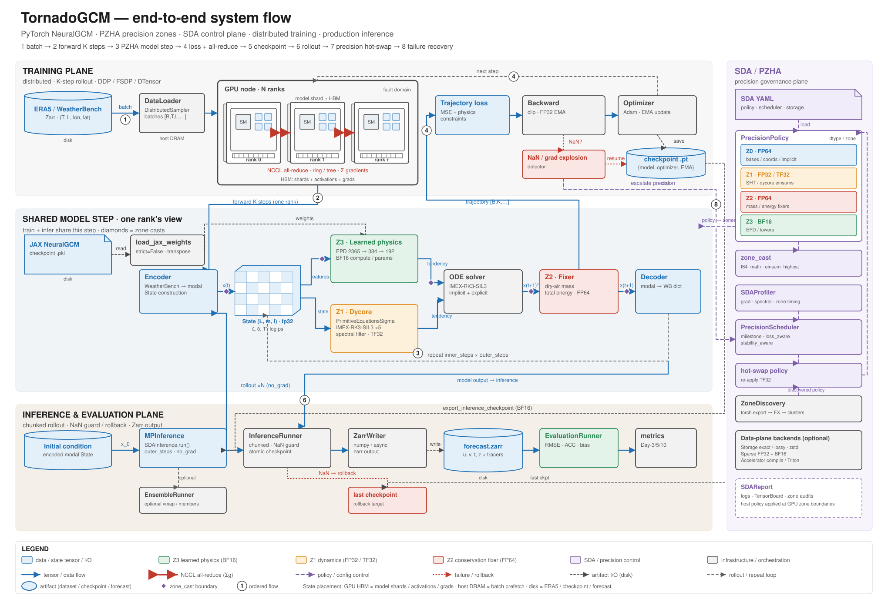

# Architecture

TornadoGCM couples a spectral primitive-equation dycore with learned physics.
The design follows the original JAX NeuralGCM codebase closely; the module
layout intentionally mirrors it (`dinosaur` → `core/`, `neuralgcm` →
`neural/`).



*Figure 1 — End-to-end system flow. Distributed training and production
inference share the same PZHA model step. The SDA control plane (right)
profiles, schedules, and hot-swaps precision; small diamonds mark
`zone_cast` boundaries. Steps 1–8 trace one run from data to forecast, and
the legend records line semantics and state placement (GPU HBM, host DRAM,
and disk). [Open the full-size SVG](assets/architecture.svg).*

## One model step

```
WeatherBench dict (u, v, t, z, tracers)
  → WeatherbenchToPrimitiveEncoder          # nodal → modal
  → core.primitive_equations.State          # spectral coefficients
  → NeuralGCMModel.step()                   # one physics step
      1. learned physics parameterization                    Z3 / BF16
      2. dycore + IMEX-RK3-SIL3 × dycore_substeps + filter  Z1 / TF32
      3. conservation fix (dry-air mass, total energy)      Z2 / FP64
  → PrimitiveToWeatherbenchDecoder          # modal → nodal
```

The physics tendency is computed once per outer step and held constant
across the dycore substeps. Each substep is integrated with
`imex_rk_sil3` at `dt / dycore_substeps`, followed by a modal spectral
filter. After the inner loop, the conservation fixer restores dry-air mass
and total energy. `NeuralGCMModel.forward()` returns
`(final_state, trajectory)`.

## State representation

`core.primitive_equations.State` is **modal** (spectral):

| Field | Shape |
|---|---|
| `vorticity` | `(layers, m, l)` |
| `divergence` | `(layers, m, l)` |
| `temperature_variation` | `(layers, m, l)` |
| `log_surface_pressure` | `(1, m, l)` |
| `tracers` | dict of `(layers, m, l)` |

The `m` axis is ordered `[0, +1, -1, +2, -2, ...]`, `l` is ascending, and
coefficients with `|m| > l` are structural zeros. The modal array is not
square-symmetric.

Nodal tensors use `(..., lon, lat)` with the vertical axis at `-3`; layers
run from the top of the atmosphere to the surface. Neural feature code
converts modal → nodal internally.

## Coordinates and grids

`core.coordinate_systems.CoordinateSystem` combines a
`core.spherical_harmonic.Grid` with a vertical coordinate:

- `SigmaCoordinates` — normalized pressure, boundaries `0 → 1`.
- `HybridCoordinates` — `P = a + b · P_surface`.
- `LayerCoordinates` — multi-layer shallow-water coordinates.
- `PressureCoordinates` — pressure-level interpolation.

`Grid.construct(max_wavenumber, gaussian_nodes)` and the `T21`, `T42`,
`T213`, and `T425` factories build grids. Transform and differential
operators include `to_nodal`, `to_modal`, `d_dlon`, `cos_lat_d_dlat`,
`div_cos_lat`, `curl_cos_lat`, `laplacian`, and `clip_wavenumbers`.
The latter drops the top wavenumber after tendency computations to control
aliasing.

## Package map

| Package | Responsibility |
|---|---|
| `core/` | Spherical harmonics, coordinates, primitive equations, IMEX time integration, filters, vertical interpolation |
| `neural/` | Feature extraction, towers/layers, parameterizations, encoders/decoders, conservation fixers |
| `model/` | Model assembly (`NeuralGCMModel`), JAX checkpoint conversion |
| `precision/` | PZHA policy, zone casting, SDA configuration/control, zone discovery, storage/sparse/accelerator |
| `training/` | Trainer, SDA trainer, losses, schedules, data pipeline, checkpointing, evaluation |
| `inference/` | Mixed-precision runners, production runner, Zarr/numpy writers |
| `distributed/` | DDP/FSDP wrappers and DTensor sharding |
| `configs/` | SDA YAML profiles for 0.7°, 1.4°, and 2.8° grids |
| `data/` | Hybrid vertical-level definitions (ECMWF-137, UFS-127) |

## Neural parameterization

The production path is `JaxAlignedDivCurlParameterization`:

```
CombinedFeatures
  → SequentialTransform(ShiftAndNormalize → InverseLevelScale → SoftClip)
  → pack_features
  → ForwardTower(Epd)
  → InverseShiftAndNormalize + TendencyTransform
  → div/curl
  → modal State
```

The EPD input width is fixed at **2365 features**, and feature dictionaries
are packed in **alphabetically sorted key order**. Both are load-bearing:
bypassing this path changes the width and breaks pre-trained weights.

## Checkpoint conversion

`model/jax_checkpoint_loader.py` implements the JAX → PyTorch path:

1. `load_jax_checkpoint` flattens a JAX pickle into a `params/...` dict.
2. `build_weight_mapping` maps Haiku paths to PyTorch state-dict keys.
3. `_convert_param` transposes Linear weights `(in, out) → (out, in)` and
   permutes Conv1d weights `(kernel, in, out) → (out, in, kernel)`.
4. `load_jax_weights` loads the converted tensors, optionally with
   `strict=False` to report unmapped or missing entries.

`build_jax_aligned_experiment_model()` wires the complete model, including
the feature pipeline and conservation fixer, and uses the JAX-aligned
nondimensional time step `0.525024` (approximately one hour) with five
dycore substeps.

## Training and inference

`MixedPrecisionTrainer(model, optimizer, loss_fn, ...)` provides
`train_step` and FP32 EMA updates. `SDATrainer` wraps it with the SDA
controller and adds `fit`. Checkpoint I/O is separate, in
`training/checkpointing.py`.

`MPInference(model, policy=None)` provides `run`, `run_chunked`, and
`run_streaming`. `inference/production.py::InferenceRunner` adds chunking,
NaN detection with rollback, and Zarr/numpy output writers.

`distributed/` exposes `setup_distributed`, `wrap_ddp`, `wrap_fsdp`, and
DTensor sharding (enabled with `NEURALGCM_DTENSOR_ENABLED`). These helpers
are standalone; only metric all-reduce and the distributed sampler are
wired into the trainer.
